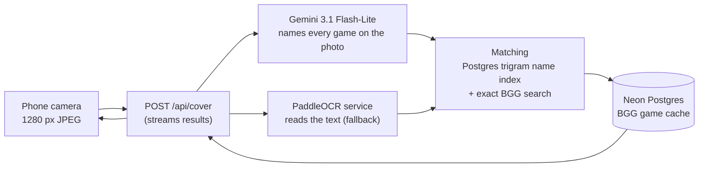

<p align="center">
  
</p>

<h1 align="center">Meeple Scan</h1>

<p align="center">
  Photograph a board game box, or a whole shelf, and see each game's BoardGameGeek rating, complexity and best player count.
</p>

<p align="center"><a href="https://meeple-scan.com"><strong>meeple-scan.com</strong></a></p>

<p align="center">
  
  
  
  
  
  
  <a href="LICENSE"></a>
</p>

---

## What it does

- **Scan** a box or a shelf with the phone's camera. Each game found is shown one by one; you confirm it (or pick the right one) before its details appear. If camera access is refused, a photo can be picked from the gallery instead.
- **Game card**: BGG rating and rank, complexity, best player count with BGG's full player-count poll, age, play time, mechanics, and a link to BoardGameGeek.
- **Rankings**: BGG's hot list (refreshed daily) and the 100 best-ranked games, prerendered and rebuilt at most hourly.
- **Search**: any BGG game by name, typo-tolerant ("wingspam" finds Wingspan).
- **History** of confirmed games, kept on the phone.
- **Settings**: language, feedback form, link to this repository.
- **On a computer**, the home page is a landing page instead of the camera: a QR code to open the app on a phone, the hot games (each linking to BoardGameGeek), a FAQ and the feedback form. The camera is never requested there.
- **10 languages**: English, German, French, Spanish, Portuguese (Brazil), Italian, Polish, Japanese, Simplified Chinese, Korean. Detected from the browser, with per-language URLs and SEO tags.
- A web app you can add to the home screen (PWA).

## How a photo becomes a game



1. The phone sends the framed part of the camera picture to `POST /api/cover`.
2. **Gemini** and the **OCR service** read it at the same time. Gemini names each game it sees (title as printed and BoardGameGeek name); when it names nothing that matches, the biggest OCR titles are used instead.
3. Each name is matched against **our own index of the names of ~40k BGG games** (Postgres `pg_trgm`, typo-tolerant), then BGG's **exact** search for games too new to be indexed. Candidates are ranked by name similarity, popularity and the edition the box spells out.
4. Game details come from a **shared cache** in Postgres, refreshed from BGG weekly (top 1000) and daily (hot list).
5. Results stream back as newline-delimited JSON, so the first game shows while the others are still being looked up.

On the evaluation photos (BGG covers, real gallery photos, phone shots, shelves), this gets the right game first about **90%** of the time. See [Evaluation](#evaluation).

## Tech stack

| | |
|---|---|
| App | [Next.js 16](https://nextjs.org) (App Router, Cache Components, `proxy.ts`), React 19, TypeScript |
| UI | Tailwind CSS 4, [shadcn/ui](https://ui.shadcn.com) on [Base UI](https://base-ui.com), Motion, Lucide icons |
| Data | [Neon](https://neon.tech) Postgres, [Drizzle ORM](https://orm.drizzle.team), `pg_trgm` |
| Recognition | [Gemini 3.1 Flash-Lite](https://ai.google.dev) and a self-hosted [PaddleOCR](https://github.com/PaddlePaddle/PaddleOCR) service ([`ocr-service/`](ocr-service)) |
| Game data | [BoardGameGeek XML API 2](https://boardgamegeek.com/wiki/page/BGG_XML_API2) and BGG's ranks data dump |
| Hosting | [Vercel](https://vercel.com) (Fluid Compute, Cron Jobs) |
| Tests | [Vitest](https://vitest.dev) (unit), [Playwright](https://playwright.dev) (end to end, with a fake camera and fake API) |

## Getting started

### Prerequisites

- Node.js 24 and [pnpm](https://pnpm.io) 10
- A Postgres database (a free [Neon](https://neon.tech) project works)
- A [BoardGameGeek XML API token](https://boardgamegeek.com/applications)
- Optional: a [Gemini API key](https://aistudio.google.com) and the OCR service (see [`ocr-service/README.md`](ocr-service/README.md)). Without either, photos can't be read, but search, rankings and history still work.

### Setup

```bash
git clone https://github.com/anzieu-labs/meeple-scan.git
cd meeple-scan
pnpm install
cp .env.example .env.local   # then fill it in, see below
pnpm db:migrate              # creates the tables
```

Fill the name index with BGG's ranked games (needed for typo-tolerant matching, search and rankings). Download the ranks dump from [boardgamegeek.com/data_dumps/bg_ranks](https://boardgamegeek.com/data_dumps/bg_ranks) while logged in, then:

```bash
pnpm import:ranks data/bgg-ranks/boardgames_ranks_YYYY-MM-DD.zip
```

Start the app:

```bash
pnpm dev
```

Open [http://localhost:3000](http://localhost:3000). The camera needs HTTPS on a phone: use a tunnel (for example `ngrok http 3000`) or the Vercel preview.

### Environment variables

| Variable | Needed for | |
|---|---|---|
| `DATABASE_URL`, `DATABASE_URL_UNPOOLED` | everything | Postgres connection strings (pooled and direct) |
| `BGG_API_TOKEN` | everything | BoardGameGeek XML API token |
| `GEMINI_API_KEY` | photos | Gemini key. Use a paid-tier key: free-tier requests may be used for training. `GEMINI_MODEL` overrides `gemini-3.1-flash-lite` |
| `OCR_URL`, `OCR_API_KEY` | photos | Address and key of the OCR service |
| `CRON_SECRET` | production | Protects the refresh jobs (`/api/cron/*`); any long random string |

## Scripts

| | |
|---|---|
| `pnpm dev` | Development server |
| `pnpm build` / `pnpm start` | Production build and server |
| `pnpm lint` | ESLint |
| `pnpm typecheck` | Route types and TypeScript |
| `pnpm test` | Unit tests (Vitest) |
| `pnpm test:e2e` | End-to-end tests (Playwright, needs Google Chrome and a production build: `pnpm build` first) |
| `pnpm db:generate` | New migration from `db/schema.ts` |
| `pnpm db:migrate` | Apply migrations (Vercel runs this on every deploy) |
| `pnpm db:studio` | Browse the database (game cache, photo logs, feedback) |
| `pnpm import:ranks <zip>` | Import BGG's ranks dump into the name index |
| `pnpm export:photo-logs` | Turn logged photos into evaluation data |
| `pnpm stats [days]` | Visits by source (QR code, `?ref=`, `?utm_source=`, referring site), how many scanned, photos, installs, feedback |
| `pnpm screenshots` | The phone screens on the desktop landing, in every language (`public/screens/`; needs `pnpm build`) |

## Project structure

```
app/
  [lang]/              pages, one copy per language (English at "/", others at "/fr", "/de"…)
  api/                 cover (photo → games), search, games, feedback, photo logs, cron jobs
  manifest.ts, robots.ts, sitemap.ts, opengraph-image.tsx, icons
components/            scanner and its sheet, game cards, tabs, settings, desktop landing
lib/
  matching/            reading titles, name similarity, ranking candidates, Gemini matching
  game/                game cache, name index, rankings, search, photo logs
  bgg/                 BoardGameGeek API client and XML parsing
  gemini/, ocr/        recognition clients
  i18n/                languages, detection, dictionaries, number and plural formatting
db/schema.ts           Drizzle schema; migrations in drizzle/
proxy.ts               picks each page's language
ocr-service/           PaddleOCR HTTP service (Docker)
ocr-eval/              recognition benchmark
e2e/                   Playwright tests
```

## Languages

The URL decides the language: English pages live at `/rankings`, the others under a prefix (`/fr/rankings`). On an address without a prefix, [`proxy.ts`](proxy.ts) sends the visitor to the language they picked in Settings (a cookie), or else to the best match for their browser's languages.

All the app's text is in [`lib/i18n/dictionaries/`](lib/i18n/dictionaries). English (`en.ts`) is the source; the type check fails if another language misses a string, and a unit test checks that every translation keeps the English placeholders.

To add a language:

1. Add its code to `LOCALES` and its name to `LOCALE_NAMES` in [`lib/i18n/config.ts`](lib/i18n/config.ts), and its link-preview locale in [`lib/site.ts`](lib/site.ts).
2. Copy `fr.ts` to `<code>.ts`, translate it, and register it in [`lib/i18n/dictionaries/index.ts`](lib/i18n/dictionaries/index.ts).
3. Run `pnpm typecheck && pnpm test`.

Native-speaker reviews of the translations are very welcome.

## Evaluation

[`ocr-eval/`](ocr-eval) measures how often a photo gives the right game: official covers, BGG gallery photos, generated phone shots and shelves, split into a tuning half and a held-out half. Each script explains its use at the top: `fetch_gallery.py` (photos), `make_photos.py` (phone shots and shelves), `run_ocr.py` (OCR), then:

```bash
OCR_EVAL=1 pnpm exec vitest run ocr-eval
```

Photos and results stay in `ocr-eval/data` and `ocr-eval/out`, which are git-ignored: gallery photos belong to the people who uploaded them.

## Deployment

The app is made for Vercel: connect the repository, add the environment variables, and deploy. Each build runs the database migrations first (`vercel-build`). Three cron jobs ([`vercel.json`](vercel.json)): the top 1000 BGG games weekly and the hot list daily keep the cache fresh, and a daily cleanup deletes what the privacy page says isn't kept ([`lib/retention.ts`](lib/retention.ts)).

The OCR service runs anywhere Docker does; [`ocr-service/README.md`](ocr-service/README.md) covers running it locally and deploying it on Coolify.

## Data and privacy

The app's [privacy page](https://meeple-scan.com/privacy) says the same, for users.

- **Photos are never stored.** They are read by the OCR service and by Gemini on a paid plan (Google doesn't use paid-tier requests to improve its products). Each photo log keeps only the text OCR read, the names Gemini gave, the games shown and what the user confirmed or picked instead, to improve matching. No IP address or device id. Kept 12 months.
- **Usage events** ([`lib/events`](lib/events)) count visits (page, language, phone or computer, `?ref=`/`?utm_source=` or the referring site), photos (camera or gallery) and installs, in our own `events` table instead of a paid analytics plan. No cookie, no IP address, nothing stored on the device: a random id held in memory ties one page load's events together. Automated browsers and bots aren't counted. Kept 12 months. Read them with `pnpm stats`.
- History stays on the phone (`localStorage`).
- Feedback keeps the message, the language, and an email only if the sender gives one. Kept 24 months.

## Credits

Game data and ratings come from [BoardGameGeek](https://boardgamegeek.com) through its XML API, as its terms require the "Powered by BGG" attribution shown in the app. Meeple Scan is not affiliated with BoardGameGeek.

## Contributing

Issues and pull requests are welcome. Before opening a pull request, run:

```bash
pnpm lint && pnpm typecheck && pnpm test
```

and `pnpm build && pnpm test:e2e` for changes to the interface. Agent and contributor notes about this Next.js version are in [`AGENTS.md`](AGENTS.md).

## License

[MIT](LICENSE) © 2026 Anzieu Labs Inc. Game data, ratings and box art belong to BoardGameGeek and the games' publishers, and are not covered by this license.
